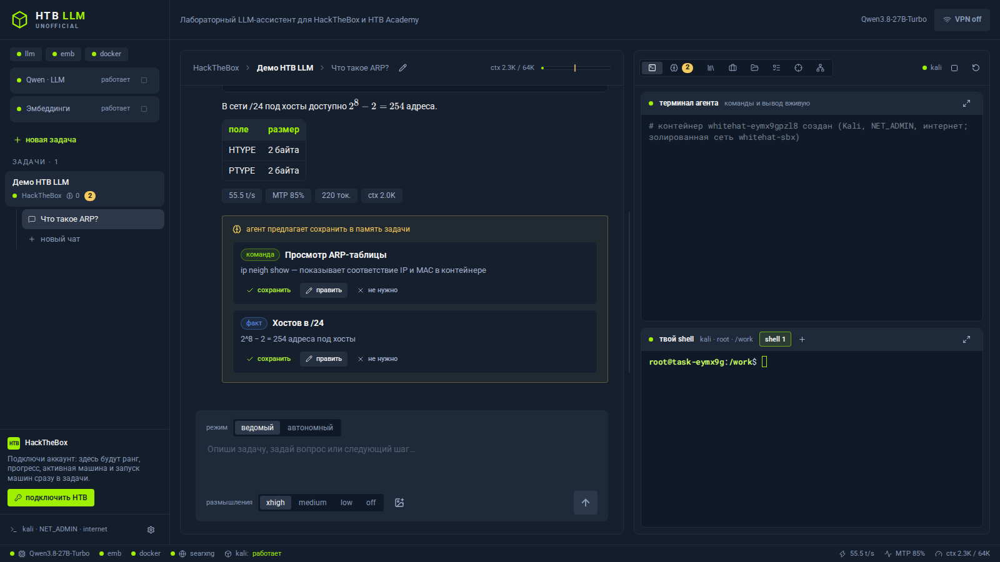
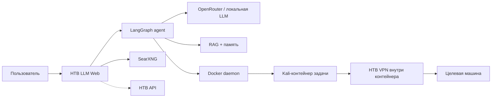

<p align="center">
  
</p>

<h1 align="center">HTB LLM</h1>

<p align="center">
  <b>Неофициальный локальный LLM-ассистент для HackTheBox и HTB Academy</b><br />
  Kali на каждую задачу · VPN внутри контейнера · терминалы и jobs · RAG · память · план и профиль цели
</p>

<p align="center">
  
  
  
  
</p>

> [!IMPORTANT]
> **HTB LLM — независимый community-проект.** Он не является продуктом HackTheBox, не аффилирован с HackTheBox и не одобрен ими. Название и интерфейс лишь указывают назначение и визуально вдохновлены HTB Labs. Используйте инструмент только в HackTheBox/HTB Academy, CTF и собственных авторизованных лабораториях.

<p align="center">
  
</p>

## Что это

HTB LLM — управляемый рабочий стол для решения HTB-машин вместе с LLM. Модель не «решает всё сама»: по умолчанию включён guided-режим, где пользователь направляет работу, а ассистент выполняет ограниченные этапы, показывает команды и выводы и останавливается для следующего указания.

Каждая задача получает:

- отдельный Kali-контейнер и каталог `work/` со структурой `scans/`, `exploits/`, `www/`, `loot/`, `notes/`;
- VPN внутри контейнера задачи, поэтому reverse shell приходит прямо на tun-интерфейс;
- терминал агента, несколько пользовательских shell-вкладок и фоновые jobs/listener-сессии;
- план по фазам, профиль цели с сервисами/кредами/доступами и подтверждаемую память;
- локальный RAG по методикам и инструментам без готовых writeup-решений;
- опциональную синхронизацию прогресса и машин через HTB API.

## Возможности

- **Модели:** локальная OpenAI-compatible модель, OpenRouter или свой API — отдельно для LLM и эмбеддингов.
- **OpenRouter из коробки:** пресеты `z-ai/glm-5.3-flash` (provider/quantization настраиваются) и `cohere/embed-5-fast`, проверка соединения, статистика расходов двумя ключами.
- **Reasoning по модели:** селектор усилий строится из метаданных модели. GLM 5.3 Flash, например, показывает только `max/high/low`, потому что reasoning у неё обязателен.
- **Подагенты:** на внешних пресетах главная модель может делегировать исследование `spawn_subagent` с чистым контекстом и лимитами.
- **Типизированные инструменты:** `nmap_scan`, `ffuf_scan`, `sqlmap_scan`, HTTP-сессии с cookie, TCP-диалоги, веб-поиск через собственный SearXNG.
- **Без спойлеров:** серверная политика блокирует поиск и чтение готовых walkthrough/writeup по текущей машине, пока пользователь явно не разрешит это на конкретный ход.
- **Контекст не теряется:** план, профиль цели, Decision Log, советник при застревании, авто-подсказки searchsploit и «рецепт захода» после флага.

## Быстрый старт в Docker

Требуется Linux, Docker Engine и Docker Compose v2. Приложение управляет Kali-контейнерами через host Docker socket, поэтому запуск рассчитан на доверенную локальную машину.

**Windows:** нативно не поддерживается — запускайте внутри WSL2 (Ubuntu): включите в Docker Desktop интеграцию с вашей WSL-дистрибуцией (Settings → Resources → WSL integration), клонируйте репозиторий в домашний каталог WSL (не на `/mnt/c/...`, иначе bind-пути Kali-контейнеров и скорость будут проблемой) и дальше всё как в Linux. PowerShell-обёртки нет: `docker/run.sh` — bash-скрипт и сам откажется работать вне Linux. Ручных донастроек хоста не нужно: `/dev/net/tun` для VPN внутри Kali-контейнеров сервер выдаёт сам при создании контейнера (cgroup-правило + узел устройства), нужен лишь актуальный Docker Desktop.

```bash
git clone https://github.com/LywwKkA-aD/htb-llm.git
cd htb-llm
./docker/run.sh
```

Скрипт соберёт образ приложения и Kali, запустит SearXNG и веб-интерфейс. Затем откройте:

**http://127.0.0.1:7331**

Первая сборка Kali занимает время и несколько гигабайт: в образе HTB-арсенал, SecLists, инструменты AD, bloodyAD, Katana и другие утилиты из [docker/kali/Dockerfile](docker/kali/Dockerfile).

### Первая настройка

1. Нажмите шестерёнку внизу левой панели.
2. Для основной модели выберите **OpenRouter**, введите API-ключ и проверьте соединение. Модель, provider и quantization можно изменить.
3. Для эмбеддингов выберите OpenRouter/Cohere или свой endpoint. Если размерность отличается от индекса, интерфейс покажет предупреждение.
4. При желании добавьте management-ключ OpenRouter для статистики расходов и токенов.
5. Постройте базу знаний после настройки эмбеддингов: прямо в настройках есть кнопка **«Скачать и построить базу»** — сервер сам скачает внешние корпуса зафиксированных ревизий и проиндексирует их вместе с собственными гайдами проекта (ход и лог видны там же). Тот же пайплайн из терминала:

   ```bash
   ./docker/run.sh knowledge
   ```

   Без этого шага индекс пуст (`0 фрагментов`), а кнопка «переиндексировать» неактивна — переиндексировать пока нечего; она нужна позже, при смене модели эмбеддингов.

6. Создайте задачу вручную или подключите HTB API-токен и импортируйте машину. VPN-конфиг импортируется из вкладки VPN внутри задачи.

### Управление Docker-запуском

```bash
./docker/run.sh status
./docker/run.sh logs app
./docker/run.sh down
./docker/run.sh build
./docker/run.sh knowledge
```

`down` останавливает приложение и SearXNG, но не удаляет `data/` и не трогает уже запущенные Kali-контейнеры задач.

## Как устроено



- **Приложение в Compose** получает Docker socket и создаёт отдельный Kali-контейнер на задачу. Рабочий каталог задачи bind-mount-ится в `/work`, поэтому файлы видны и из UI, и с хоста в `data/tasks/<id>/work`.
- **VPN живёт внутри Kali**, а не в приложении: reverse shell и SOCKS для браузера/Burp работают без NAT-костылей между приложением и целью.
- **Вкладка «Браузер»** — графический Firefox (Selkies-стриминг, без VNC) сайдкаром в сетевом пространстве задачи: веб цели открывается через её VPN напрямую, без прокси-настроек; образ скачивается при первом включении.
- **Вкладка «Прокси»** — Caido (Burp-аналог с родным веб-интерфейсом) в контейнере задачи: история, перехват и Repeater без установки Burp на хост; бинарь скачивается сервером при первом включении, проекты и CA хранятся в `/work` задачи.
- **Модель управляемая:** guided-режим ограничивает число action-раундов на этап; справочные вызовы бюджет не съедают. Автономный режим включается явно в чате.
- **Данные локальные:** SQLite, настройки, ключи, VPN-конфиги, файлы задач и RAG-индекс лежат в `data/`. Этот каталог не входит в Git.

## Знания и лицензии источников

Собственные карточки проекта лежат в [knowledge/](knowledge/) и входят в репозиторий. Большие внешние корпуса **не перераспространяются** с этим репозиторием: скрипт скачивает их из первоисточников на машину пользователя и индексирует локально. Точные ревизии зафиксированы в [knowledge/sources.lock.json](knowledge/sources.lock.json), чтобы у друга собрался тот же набор знаний, а не случайный свежий HEAD.

| Источник | Лицензия по данным upstream | Как используется |
|---|---|---|
| HackTricks | CC BY-NC 4.0 | локальная загрузка и индексация |
| PayloadsAllTheThings | MIT | локальная загрузка и индексация |
| InternalAllTheThings | нет файла лицензии | только локальное использование; не публикуйте скачанный корпус |
| GTFOBins | GPL-3.0 | локальная загрузка и индексация |
| LOLBAS | GPL-3.0 | локальная загрузка и индексация |

Обновить источники до свежих HEAD можно осознанно: `WH_KNOWLEDGE_LATEST=1 ./docker/run.sh knowledge`. Для воспроизводимой установки обычный запуск использует lock.

## Безопасность

> [!WARNING]
> Доступ приложения к `/var/run/docker.sock` фактически эквивалентен root на хосте. Запускайте HTB LLM только локально на доверенной машине, не публикуйте порт 7331 в интернет и не давайте доступ к UI посторонним.

- Интерфейс слушает только `127.0.0.1` в Compose; Host/Origin-guard защищает API от DNS-rebinding и чужих страниц.
- Kali-контейнеры задач получают `NET_ADMIN` для VPN и сетевых инструментов. Это нужно для HTB, но усиливает требование доверять локальной среде.
- При внешнем провайдере модели контекст задачи, ввод пользователя и выводы инструментов уходят выбранному API-провайдеру. Не отправляйте туда данные, которые нельзя раскрывать.
- HTB-токен, API-ключи и VPN-конфиги хранятся в локальной БД/файлах `data/`. Не коммитьте и не публикуйте этот каталог.
- Политика спойлеров — серверная: web-поиск, fetch и сетевые обёртки блокируют готовые решения текущей машины без явного разрешения пользователя на ход.

## Локальные модели и хостовый режим

Docker-режим по умолчанию рассчитан на OpenRouter или внешние endpoints. Если llama-server уже работает на хосте, локальные пресеты в Compose смотрят на `host.docker.internal:8080` (LLM) и `:8081` (эмбеддинги). Кнопки управления локальными процессами внутри Docker отключены (`WH_SERVICES=off`): запускайте llama-server своим обычным способом.

Для разработки без Docker нужен Node 24 и pnpm 12:

```bash
corepack enable
corepack prepare pnpm@12.11.2 --activate
pnpm install --frozen-lockfile
pnpm build
docker build -t htb-llm-kali:latest docker/kali
bin/htb-llm start --web-only --no-open
```

## Разработка

```bash
pnpm build          # веб-интерфейс
pnpm test:e2e       # Playwright e2e на мок-модели и настоящем Kali
pnpm knowledge      # скачать/обновить источники знаний и построить RAG (хостовый режим)
./docker/run.sh     # полный Docker-запуск
```

E2E не требуют настоящую LLM: тесты используют детерминированный мок OpenAI API и изолированный каталог данных. Перед изменениями в графе, инструментах или Docker прочитайте [AGENTS.md](AGENTS.md).

## Лицензия

Код проекта распространяется под [MIT License](LICENSE). Внешние источники знаний не входят в репозиторий и остаются под своими лицензиями, перечисленными выше. HackTheBox и HTB — товарные знаки их владельцев; этот проект не аффилирован с ними.

